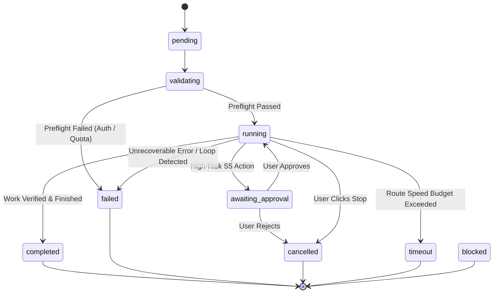

# NEXUS.AI V2 — Live API & Architecture Contract

**Generated From Source Audit:** October 27, 2026  
**Scope:** Strict documentation of the implemented HTTP routes, Server-Sent Events (SSE), shared type definitions, and Task State Machine.  
**Source Baseline:** Commit `d749cbc` (`packages/server/src/api/routes/`, `packages/core/src/types/`, `packages/client/src/services/api.ts`)

---

## 1. HTTP API Route Specifications

All endpoints are hosted under the base prefix `/api`.

### 1.1 System Health
* **`GET /api/health`**
  * **Request Body:** None
  * **Success Response (200 OK):**
    ```json
    {
      "status": "ok",
      "service": "NEXUS.AI Backend",
      "version": "1.0.0",
      "uptime": 12.34,
      "timestamp": 1793081959180
    }
    ```
  * **Error Statuses:** None (always returns 200).

---

### 1.2 Workspaces (`/api/workspaces`)
* **`GET /api/workspaces`**
  * **Description:** Lists recent workspaces tracked by `WorkspaceService`.
  * **Response (200 OK):** `{ "success": true, "workspaces": WorkspaceInfo[] }`

* **`POST /api/workspaces/open`**
  * **Request Body:** `{ "targetPath"?: string, "path"?: string }`
  * **Response (200 OK):** `{ "success": true, "workspace": WorkspaceInfo }`
  * **Errors:** 400 (`WorkspaceError` on invalid path or traversal attempt).

* **`GET /api/workspaces/tree`**
  * **Query Params:** `workspace` (or `path`) [string, required], `depth` [number, optional, default: 6]
  * **Response (200 OK):** `{ "success": true, "tree": WorkspaceTreeNode }`
  * **Errors:** 400 (`WorkspaceError` if workspace parameter missing or path invalid).

* **`GET /api/workspaces/file`**
  * **Query Params:** `workspace` [string, required], `file` [string, required], `startLine` [number, optional], `endLine` [number, optional]
  * **Response (200 OK):** `{ "success": true, "content": string, "totalLines": number, "startLine": number, "endLine": number, "isBinary": boolean, "byteLength": number }`
  * **Errors:** 400 (`WorkspaceError` or `PathTraversalError` if path escapes workspace root).

* **`GET /api/workspaces/metadata`**
  * **Query Params:** `workspace` [string, required], `file` [string, required]
  * **Response (200 OK):** `{ "success": true, "metadata": { "size": number, "createdAt": number, "modifiedAt": number, "isDirectory": boolean, "extension": string } }`

* **`GET /api/workspaces/search`**
  * **Query Params:** `workspace` [string, required], `q` [string, required], `pattern` [string, optional]
  * **Response (200 OK):** `{ "success": true, "result": { "query": string, "matches": WorkspaceSearchMatch[], "totalMatches": number } }`

* **`POST /api/workspaces/terminal`**
  * **Request Body:**
    ```json
    {
      "command": "npm test",
      "workspacePath": "C:\\Users\\BMS\\Desktop\\nexux",
      "workingDir": "packages/core",
      "timeoutMs": 30000
    }
    ```
  * **Behavior Note (Security Finding):** Uses `workspacePath || globalWorkspaceService.getCurrentWorkspace()?.path || process.cwd()`.
  * **Response (200 OK):**
    ```json
    {
      "success": true,
      "data": {
        "stdout": "...",
        "stderr": "",
        "exitCode": 0,
        "durationMs": 124
      },
      "error": null,
      "durationMs": 124
    }
    ```
  * **Errors:** 400 (`WorkspaceError` or command policy violation error).

---

### 1.3 Providers (`/api/providers`)
* **`GET /api/providers/status`**
  * **Response (200 OK):**
    ```json
    {
      "success": true,
      "providers": {
        "openai": { "configured": boolean, "status": "VALID" | "NOT_CONFIGURED", "id": "openai", "name": "OpenAI", "maskedKey": "sk-...1234", "models": ["gpt-4o", "gpt-4o-mini", "o1", "o3-mini"], "defaultModel": "gpt-4o" },
        "gemini": { "configured": boolean, "status": "VALID" | "NOT_CONFIGURED", "id": "gemini", "name": "Google Gemini", "maskedKey": "AIza...5678", "models": ["gemini-2.5-flash", "gemini-2.5-pro"], "defaultModel": "gemini-2.5-flash" }
      },
      "hasAnyValidProvider": boolean,
      "activeProviders": string[],
      "routingTable": Record<string, { provider: string; model: string }>
    }
    ```

* **`POST /api/providers/credentials`**
  * **Request Body:** `{ "provider"?: "openai" | "gemini", "apiKey"?: string, "openaiApiKey"?: string, "geminiApiKey"?: string }`
  * **Response (200 OK):** `{ "success": true, "message": "Credentials updated successfully", "hasAnyValidProvider": boolean }`

* **`POST /api/providers/validate`**
  * **Request Body:** `{ "provider": "openai" | "gemini", "apiKey"?: string, "model"?: string }`
  * **Response (200 OK):**
    ```json
    {
      "success": boolean,
      "result": { "provider": string, "isValid": boolean, "message"?: string, "code"?: string, "testedAt": number },
      "validation": { ... }
    }
    ```

---

### 1.4 Tasks (`/api/tasks`)
* **`GET /api/tasks`**
  * **Query Params:** `sessionId` [string, optional], `limit` [number, optional]
  * **Response (200 OK):** `{ "success": true, "tasks": Task[] }`

* **`GET /api/tasks/active`**
  * **Response (200 OK):** `{ "success": true, "activeTask": Task | null, "activeTaskId": string | null, "status": string }`

* **`POST /api/tasks` (CRITICAL CONTRACT)**
  * **Request Body:**
    ```json
    {
      "prompt": "List the files in demo folder",
      "sessionId"?: "session_123",
      "workspacePath"?: "C:\\Users\\BMS\\Desktop\\nexux",
      "provider"?: "gemini",
      "model"?: "gemini-2.5-flash"
    }
    ```
  * **Response Status Semantics:**
    * **`201 Created`**: Validation succeeded; task created and dispatched to coordinator in background.
      ```json
      {
        "success": true,
        "task": { "id": "task_1793081...", "sessionId": "session_...", "prompt": "...", "status": "pending", "stage": "created", "changedFiles": [], "activeAgents": [], "createdAt": 1793081... }
      }
      ```
    * **`200 OK` (On Preflight Credential / Model Failure):**
      Task resource is created and saved with `status: 'failed'`, returning actionable guidance without throwing browser fetch 400 exceptions.
      ```json
      {
        "success": false,
        "errorCode": "PROVIDER_AUTH_FAILED" | "MODEL_UNAVAILABLE",
        "error": "PROVIDER_AUTH_FAILED: Gemini API key is missing...",
        "task": { "id": "task_1793081...", "status": "failed", "stage": "failed", ... }
      }
      ```
    * **`400 Bad Request`**: Only returned if request body JSON is malformed or `prompt` is missing/empty string.

* **`GET /api/tasks/:id`**
  * **Response (200 OK):** `{ "success": true, "task": Task }`
  * **Response (404 Not Found):** `{ "success": false, "error": "Task not found" }`

* **`POST /api/tasks/:id/cancel`**
  * **Response (200 OK):** `{ "success": true, "message": "Task cancellation requested", "taskId": string }`

* **`GET /api/tasks/:id/events/history`**
  * **Response (200 OK):** `{ "success": true, "events": NexusEvent[] }`

* **`GET /api/tasks/:id/usage`**
  * **Response (200 OK):** `{ "success": true, "records": UsageRecord[], "totalCost": number, "totalTokens": number }`

* **`GET /api/tasks/:id/timeline`**
  * **Response (200 OK):** `{ "success": true, "timeline": TimelineEntry[] }`

* **`GET /api/tasks/:id/timeline/export`**
  * **Query Params:** `format` [ "json" | "markdown", default: "json" ]
  * **Response (200 OK):** Formatted timeline download.

---

### 1.5 Server-Sent Events (SSE) Streams
* **Global Stream: `GET /api/tasks/events/all`**
* **Task-Scoped Stream: `GET /api/tasks/:id/events`**
  * **Headers:** `Content-Type: text/event-stream`, `Cache-Control: no-cache`, `Connection: keep-alive`
  * **Format:**
    ```text
    event: nexus_event
    data: {"id":"evt_1","type":"task_progress","sessionId":"...","taskId":"...","timestamp":179308...,"stage":"routing","status":"running"}
    ```
  * **Heartbeat:** Periodically sends `: heartbeat\n\n` comments or `task_heartbeat` events to prevent proxy timeouts.

---

### 1.6 Sessions (`/api/sessions`)
* **`GET /api/sessions`**: `{ "success": true, "sessions": Session[] }`
* **`POST /api/sessions`**: Create session `{ "workspaceId"?: string, "workspacePath"?: string, "title"?: string }`
* **`GET /api/sessions/:id`**: `{ "success": true, "session": Session }`
* **`POST /api/sessions/:id/reopen`**: Reopen inactive session.
* **`DELETE /api/sessions/:id`**: Soft-delete/remove session.

---

### 1.7 Usage (`/api/usage`)
* **`GET /api/usage/records`**: Query params `taskId`, `sessionId`, `provider`, `model`, `limit`. Returns `{ "success": true, "records": UsageRecord[], "total": number }`.
* **`GET /api/usage/summary`**: Returns `{ "success": true, "summary": UsageSummary }`.

---

## 2. Server-Sent Events (SSE) Event Catalog & Payloads

Every event implements `BaseNexusEvent`:
```typescript
interface BaseNexusEvent {
  id: string;
  type: NexusEventType;
  sessionId: string;
  taskId: string;
  timestamp: number;
}
```

| Event Type | Additional Payload Fields | Ordering / Trigger Condition |
| :--- | :--- | :--- |
| `task_started` | `prompt: string` | Emitted immediately upon task dispatch. |
| `task_progress` | `stage: string`, `agentRole?: AgentRole`, `status: TaskStatus`, `message?: string`, `percent?: number` | Emitted on agent transitions, planning steps, or code syntheses. |
| `task_heartbeat` | `stage: string`, `agentRole?: AgentRole`, `status: TaskStatus`, `elapsedMs: number` | Emitted every 2.5s to 5s during active execution. |
| `agent_started` | `agentRole: AgentRole`, `goal: string` | Emitted when an agent role (e.g. planner, coder) begins its turn. |
| `agent_message` | `agentRole: AgentRole`, `content: string` | Streaming or completed message from an agent. |
| `tool_started` | `toolName: ToolName`, `arguments: Record<string, unknown>`, `toolCallId: string` | Emitted immediately before executing a workspace tool. |
| `tool_completed` | `toolName: ToolName`, `result: ToolResult`, `durationMs: number`, `toolCallId: string` | Emitted upon tool completion with execution output. |
| `file_changed` | `file: ChangedFile` | Emitted when `file_write` or `file_edit` changes a workspace file. |
| `command_started` | `command: string`, `workingDir?: string` | Emitted when `terminal` command execution begins. |
| `command_completed` | `command: string`, `exitCode: number`, `durationMs: number` | Emitted when `terminal` command completes. |
| `test_failed` | `testCommand: string`, `output: string` | Emitted by Reviewer or Supervisor during test failure verification. |
| `agent_completed` | `agentRole: AgentRole`, `summary: string`, `durationMs?: number` | Emitted when an agent finishes its milestone. |
| `task_completed` | `summary: string`, `durationMs: number`, `totalTokens?: number`, `totalCost?: number`, `changedFiles?: ChangedFile[]` | Terminal event on success. |
| `task_failed` | `error: string`, `stage?: string`, `durationMs?: number` | Terminal event on failure. |
| `task_cancelled` | `reason: string`, `durationMs?: number` | Terminal event on user cancellation. |

---

## 3. Task State Machine

### 3.1 States
- `pending`: Task created in storage, waiting for preflight or queue.
- `validating`: Checking provider credentials and model compatibility.
- `running`: Active orchestration (S1, S2, S3, or S4 supervisor workflow).
- `awaiting_approval`: Paused awaiting user authorization for high-risk actions (e.g., file deletes or terminal runs).
- `completed`: **Terminal absorbing state.** Successfully finalized.
- `failed`: **Terminal absorbing state.** Execution failed with reported root cause.
- `cancelled`: **Terminal absorbing state.** Aborted by user via `/api/tasks/:id/cancel`.
- `blocked`: **Terminal absorbing state.** Blocked by missing credentials or external requirements.
- `timeout`: **Terminal absorbing state.** Exceeded route speed budget.

### 3.2 State Transitions Diagram


### 3.3 Terminal State Invariant
Terminal states (`completed`, `failed`, `cancelled`, `timeout`, `blocked`) are **strictly absorbing**. Late asynchronous completions from LLM providers or slow tool processes are explicitly prevented from overwriting terminal states.

---

## 4. Shared Types & Client-Server Discrepancies

| Type / Interface | `@nexus/core` Source of Truth | `packages/client/src/types/index.ts` | Discrepancy & Resolution Status |
| :--- | :--- | :--- | :--- |
| `TaskStatus` | 9 states (`pending`, `validating`, `running`, `awaiting_approval`, `completed`, `failed`, `blocked`, `cancelled`, `timeout`) | 6 states (`pending`, `running`, `completed`, `failed`, `cancelled`, `blocked`) | Client is missing `validating`, `awaiting_approval`, `timeout`. **ADAPT in Prompt 04.** |
| `AgentRole` | 6 roles: `coordinator`, `explorer`, `planner`, `coder`, `debugger`, `reviewer` | 6 roles matching core. | Consistent. |
| `ProviderStatus` | Returns structured map `{ openai: ..., gemini: ... }` | Expects array `ProviderStatusItem[]` in `api.ts:24` | Client adapters normalize response. Aligned. |
| `WorkspaceTreeNode` | Recursive directory tree with `children?: WorkspaceTreeNode[]` | Matches core structure. | Consistent. |
